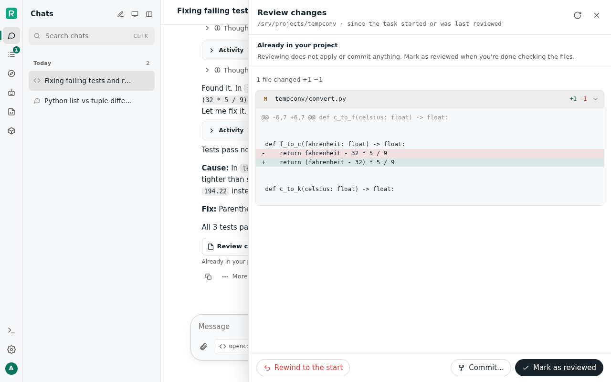
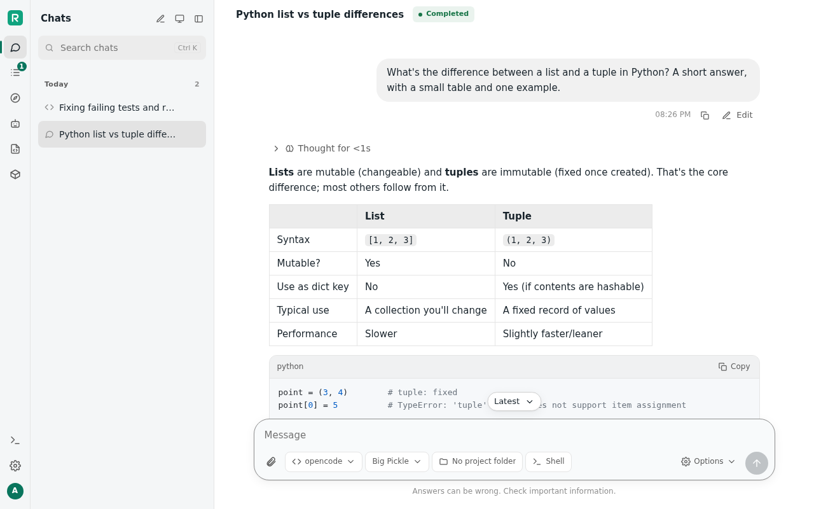
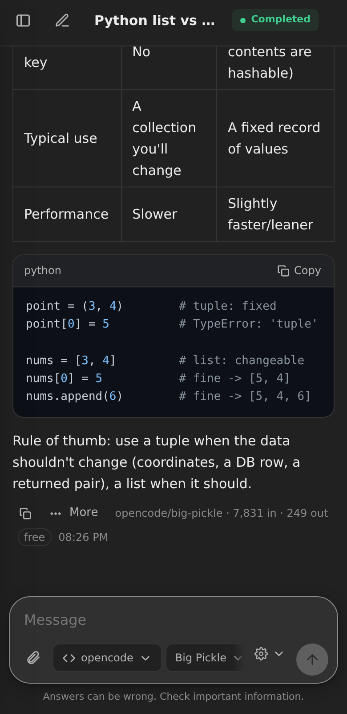

# Relay

**Your coding agents on your own server, from any browser.** Relay is a self-hosted web app for chatting with AI
models and running coding agents on a machine you own. It works with Claude Code, opencode, GitHub Copilot, any ACP
agent and OpenAI-style APIs. Start a task from your phone, close the tab, and come back to the finished work and its
diff.

<picture>
  <source media="(prefers-color-scheme: dark)" srcset="docs/images/code-task-dark.png">
  
</picture>

**Version 4.2.0.** What's new in each version is in
[docs/RELEASE-NOTES.md](docs/RELEASE-NOTES.md), and [docs/FEATURES.md](docs/FEATURES.md) lists everything Relay does.

## What it does

- **Every agent in one place.** Claude Code, opencode (with its profiles and many model providers), GitHub Copilot
  and other ACP agents, any OpenAI-compatible API (Ollama, LM Studio, a hosted one) and Perplexity.
  - **Each keeps what it has:** its own tools, MCP servers and subagents.
  - **One Relay doesn't know** is a folder of Python away: see [Adding a provider](docs/ADDING-A-PROVIDER.md).
- **Chats and code tasks.** Point an agent at a project folder and watch its tool calls, thinking and output stream
  in.
  - **Every turn is recorded:** review what changed, commit it, or rewind.
  - **Relay never commits by itself.**
- **Runs keep going.** Close the tab or lock your phone and the agent carries on. The conversation catches up when
  you're back, and a notification tells you when it's done or needs you.
- **Agents work in containers.** Each project gets its own WorkBox (rootless podman): the agent is root in there,
  with podman of its own, and only the project folder from your machine. A VPN per folder, if you like.
- **AgentOS.** A Governor agent carries out tasks while you're away: on a schedule, standing, or when you ask. It
  starts and steers other agents, keeps your services up, and asks you when it must.
- **Services.** A project becomes a live service behind Relay, with versions, health checks and rollback. Any dev
  server on the machine is at `/port/<n>/`.
- **Shared by every agent:** one memory, web search and fetch, and subagents on any provider or model. When a model
  hits its usage limit, another can take over.
- **Scripts and a Python SDK.** Drive Relay's agents from your own Python, on the Scripts page or from any machine.
- **Your other machines.** Agents can run commands and change files on your laptop or PC while a small connector
  runs there, or VSCodium.
- **Plugins.** What's new comes as a plugin, a folder Relay loads: buttons and pages, API routes, background work and
  tools for agents. See [below](#plugins) and [Writing a plugin](docs/WRITING-A-PLUGIN.md).
- **Works on your phone** (add it to your home screen), light and dark. The interface needs no internet.

<table>
  <tr>
    <td width="68%">
      <picture>
        <source media="(prefers-color-scheme: dark)" srcset="docs/images/chat-dark.png">
        
      </picture>
    </td>
    <td width="32%"></td>
  </tr>
</table>

## Plugins

Seven come with Relay, in `plugins/`. Each is off until you turn it on in **Settings → Plugins** and restart
Relay. Or link it yourself:

```sh
ln -s ~/relay/plugins/vscodium ~/.local/share/relay/plugins/vscodium
```

| | |
|---|---|
| [VSCodium](plugins/vscodium/README.md) | Relay in VSCodium and VS Code: chat, review, Keep/Undo per change, Ctrl+I, and agents asking its language servers |
| [Chrome](plugins/chrome/README.md) | Relay in Chrome's side panel, and agents in your own tabs, each step allowed by you |
| [Usage limits](plugins/usage_limits/README.md) | each usage-limit window over time, and a warning when one runs low |
| [Server](plugins/server/README.md) | the machine's CPU, memory and disks, and what each container uses |
| [ACP](plugins/acp/README.md) | Relay's agents as one ACP agent, for Zed, JetBrains, Toad and others |
| [OpenHands](plugins/openhands/README.md) | OpenHands' Agent Canvas, working with Relay's agents |
| [Notes](plugins/notes/README.md) | the worked example for writing your own |

## Is it for you?

Relay is made for **one person on their own machine**, typically a home server on the local network. Within that, it
puts usability before security:

- **Agents don't ask before each command.** They run in containers instead.
- **Containers against accidents, not attacks:** Relay protects your system from accidental damage by agents; if an agent tries to escape its container on purpose, it will.
- **No hardening:** Relay isn't made to face the internet or to be shared between people who don't trust each
  other.

Read [SECURITY.md](SECURITY.md) to see what it protects and what it leaves to you. For access from outside your
network, use a VPN such as Tailscale, or a reverse proxy with HTTPS.

## Requirements

- **The system:** 64-bit Linux (x86-64 or arm64), e.g. Debian 12/13, Ubuntu 22.04+ or Fedora.
- **Hardware:** 8 GB of RAM or more (16–24 GB if local models run on it too), and about 6 GB of disk for the
  containers' images.
- **Software:** Python 3.10+, git 2.40+, and rootless podman. Relay's Python dependencies are pure Python: nothing
  is compiled. To install it as a service, systemd.
- **At least one agent or model.** Any of these will do:
  - Claude Code, Anthropic's coding agent, with your Anthropic account;
  - [opencode](https://opencode.ai) 2: its free Zen models need no account, and it connects to many providers;
  - the GitHub Copilot CLI;
  - any OpenAI-compatible API, such as an Ollama on your network.

## Install

**What it takes:** 64-bit Linux, about 6 GB of disk, and internet for the first start, which builds Relay's container
images. As the user that will run Relay:

1. **Get the code and the system packages:**

   ```sh
   git clone https://github.com/julian-nld/relay-agents.git ~/relay && cd ~/relay
   sudo apt install podman git python3-pip curl    # Debian/Ubuntu (Fedora: sudo dnf install podman git python3-pip curl)
   ```

2. **Install the agents you want,** and sign in to them:
   - **Claude Code:** install it as Anthropic describes, then run `claude` once to sign in. Or later,
     `./relay claude` gives Relay a login of its own.
   - **opencode:** Relay needs opencode 2, which has an installer of its own (opencode.ai's main one still gives
     opencode 1): `curl -fsSL https://opencode.ai/v2/install | bash`. Then open a new shell, so `opencode` is on
     your PATH. Connect providers with `opencode auth login`; the free models need none.
   - **GitHub Copilot:** `copilot login`.

3. **Make a folder for your projects:** `mkdir ~/projects`. That's the default workspace root; Settings can add
   more.

4. **Install Relay as a service,** so it starts at boot and restarts after a crash:

   ```sh
   sh scripts/install-relay.sh --user    # a user service (recommended: rootless podman runs as you)
   sh scripts/install-relay.sh           # or: a system service running as you (asks for sudo)
   ```

   It bundles the Python dependencies (this needs internet once) and checks the machine with `./relay doctor`.
   Then it installs and starts the service, turns on lingering so the service and its containers run after a
   reboot with nobody logged in, and prints the addresses to open.
   - `--port N` serves on another port (kept in Relay's settings; `./relay port N` changes it later).
   - `--uninstall` removes the service (`--uninstall --user` for a user service). Your data stays;
     [Removing Relay](docs/GUIDE.md#removing-relay) has the rest.

   At its first start, Relay builds its containers' images: a few minutes, once. The page says so meanwhile, and
   chats, models and a provider's **Test** wait for them.

5. **Open `http://<server>:8420`** (or the port you chose) and create your account right away: the first
   visitor gets it.

**Just trying it?** Run it in the foreground instead of steps 3–4:

```sh
sh scripts/vendor.sh     # once: bundle the Python dependencies (needs internet)
./relay serve            # http://<this machine>:8420
```

**Building it yourself, running the tests, working on it:** [docs/BUILDING.md](docs/BUILDING.md).

**On another machine, without git:** make an installer bundle where you have Relay, copy it over, and install
from that:

```sh
sh scripts/make-bundle.sh    # dist/relay-<version>.tar.gz: the newest release, with its Python dependencies
# then on the other machine, as the user that will run Relay:
tar xzf relay-<version>.tar.gz && sh relay-<version>/install.sh
```

- **`install.sh`** installs podman, git and Python when they're missing (apt or dnf, asking for sudo). It puts Relay
  in `~/relay` and then does step 4, with the same options there (`--system`, `--port N`), plus `--dir DIR` and
  `--no-service`.
- **Still yours to do:** the agents (step 2).
- **Upgrading:** a newer bundle's `install.sh`, with the same options. Your data and files of your own stay.
- **What it leaves alone:** a clone of the repository (that one upgrades with `git pull`), and a Relay service of
  another folder.

## First steps

1. **Check the providers.** Relay starts with Claude Code and opencode in **Settings → Providers**. **Test**
   tries one.
   - **Others:** add them with **Add provider**.
   - **Not working:** `./relay doctor` says what's missing.
2. **A chat:** pick a provider and model under the message box, and ask. With opencode and no account, pick one
   of its free models, such as Big Pickle.
3. **A code task:** choose a project folder under the message box, then say what to do.
   - **Afterwards,** **Review changes** shows what the agent did.
4. **On your phone:** open the same address and add it to your home screen.

## Keeping it running

- **Upgrading:** `git pull`, then `systemctl --user restart relay`. Relay updates its dependencies and its database
  by itself. A restart stops what your own agents are doing (each says so, with **Retry**), so pick a quiet moment.
- **Backups:** `./relay backup` writes all of Relay's data to one archive, in the current folder (or the file
  you name).
- **When something's wrong:** `./relay doctor` checks the machine, the containers and each provider. The service's
  log is in `journalctl --user -u relay`.

- **Removing it:** [Removing Relay](docs/GUIDE.md#removing-relay).

The details are in the guide: [Running Relay](docs/GUIDE.md#running-relay).

## Documentation

| | |
|---|---|
| [Features](docs/FEATURES.md) | everything Relay does on one page, with links to where it's explained |
| [The guide](docs/GUIDE.md) | the full reference: how each thing works, and how to set it up |
| [Building from source](docs/BUILDING.md) | dependencies, images, tests, bundles, and where things are |
| [Adding a provider](docs/ADDING-A-PROVIDER.md) | bringing in an agent Relay doesn't know: a compatibility layer, step by step |
| [Writing a plugin](docs/WRITING-A-PLUGIN.md) | adding to Relay without changing it: pages, API routes, tools for agents |
| [The Python SDK](sdk/python/README.md) | Relay's agents from your own code |
| [Security](SECURITY.md) | what Relay protects, what it leaves to you, how to report a problem |
| [Release notes](docs/RELEASE-NOTES.md) | what's new, version by version, and how to upgrade |
| [Architecture](docs/ARCHITECTURE.md) | how it's built: the layers and the modules |
| [Devlog](docs/DEVLOG.md) | why things are as they are, round by round |
| [opencode-manager](docs/opencode-manager.md) | the tmux workspace for opencode that Relay builds on |

## Contributing

[CONTRIBUTING.md](CONTRIBUTING.md) has the short version. [AGENTS.md](AGENTS.md) has the working agreements and the
architecture rules, for people and coding agents alike.

## License

[MIT](LICENSE). Third-party code keeps its own license: see [THIRD-PARTY-NOTICES.md](THIRD-PARTY-NOTICES.md).
